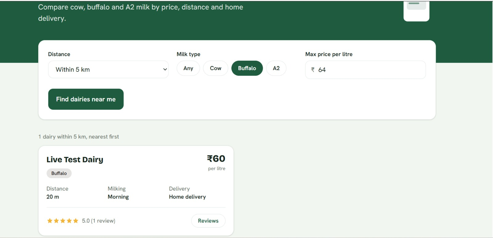
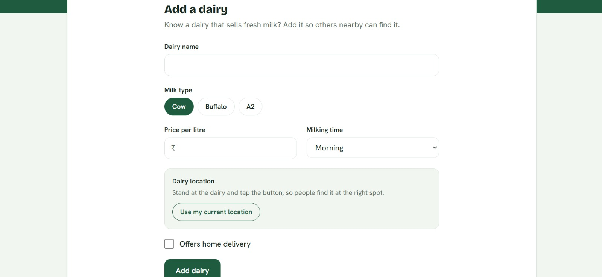
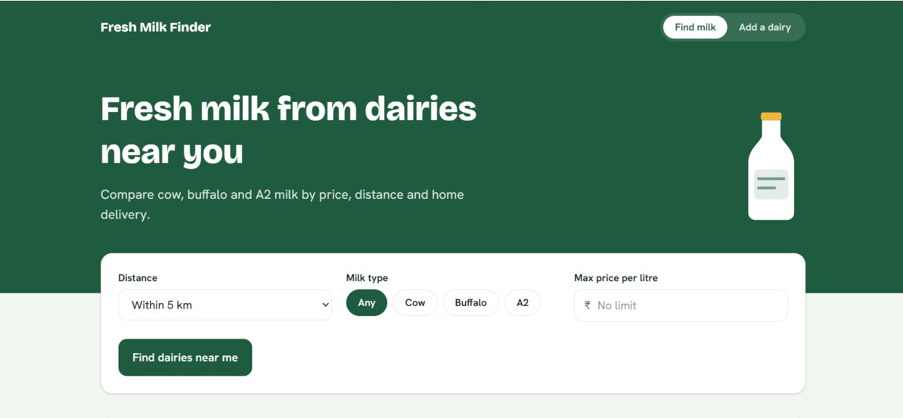

# Fresh Milk Finder

Find fresh cow, buffalo and A2 milk from dairies near you. Built for people who move to a new city and can't tell where to buy fresh milk instead of packet milk.

**Live app:** https://fresh-milk-finder.vercel.app
**API docs:** https://fresh-milk-finder.onrender.com/docs

> The backend runs on a free tier and sleeps when idle. The first search after a quiet period can take up to a minute.



## What it does

- Finds dairies near your current location, sorted from nearest to farthest
- Filters by distance, milk type (cow, buffalo, A2) and maximum price per litre
- Shows price, milking time, home delivery and distance on each dairy
- Lets anyone add a dairy, using their current location as its position
- Lets users rate dairies from 1 to 5 stars and leave comments, with live average ratings

| Add a dairy | Reviews |
|---|---|
|  |  |

## Tech stack

| Layer | Tools |
|---|---|
| Frontend | React, Vite, Tailwind CSS |
| Backend | Python, FastAPI, SQLAlchemy, Pydantic |
| Database | PostgreSQL on Neon (SQLite for local development) |
| Hosting | Vercel (frontend), Render (backend) |

## How nearby search works

The browser sends the user's latitude and longitude to `GET /vendors/nearby`. The backend uses the haversine formula to calculate the great-circle distance in kilometres between the user and every dairy, keeps the ones inside the chosen radius, applies the milk type and price filters, and returns them sorted by distance. Each result includes its average rating and review count.

## API

| Method | Endpoint | Purpose |
|---|---|---|
| POST | `/vendors/` | Add a dairy |
| GET | `/vendors/` | List dairies, with optional `milk_type` and `max_price` |
| GET | `/vendors/nearby` | Dairies near `lat` and `lng`, within `radius` km |
| GET | `/vendors/{vendor_id}` | Get one dairy |
| POST | `/vendors/{vendor_id}/reviews/` | Add a review (rating 1 to 5, optional comment) |
| GET | `/vendors/{vendor_id}/reviews/` | List reviews for a dairy |

Interactive docs are available at `/docs` on the backend URL.

## Project structure

```
Fresh-Milk-Finder/
  backend/
    app/
      routes/        # vendors and reviews endpoints
      services/      # haversine distance, vendor rating stats
      models.py      # SQLAlchemy models
      schemas.py     # Pydantic schemas
      database.py    # engine and session setup
      main.py        # app, CORS, routers
    requirements.txt
  frontend/
    src/             # React components (search, add dairy, reviews)
  docs/
    screenshots/
```

## Run it locally

**Backend**
```bash
cd backend
python -m venv venv
venv\Scripts\activate        # Windows
pip install -r requirements.txt
uvicorn app.main:app --reload
```
The API runs at http://localhost:8000 and uses a local SQLite file by default.

**Frontend**
```bash
cd frontend
npm install
npm run dev
```
The app runs at http://localhost:5173.

### Environment variables

| Variable | Where | Purpose |
|---|---|---|
| `DATABASE_URL` | Backend | Database connection string. Defaults to local SQLite |
| `CORS_ORIGINS` | Backend | Comma-separated list of allowed frontend URLs |
| `VITE_API_URL` | Frontend | Backend URL. Defaults to http://localhost:8000 |

## Deployment

- **Database:** Neon (serverless PostgreSQL)
- **Backend:** Render web service with root directory `backend`, start command `uvicorn app.main:app --host 0.0.0.0 --port $PORT`
- **Frontend:** Vercel project with root directory `frontend` and `VITE_API_URL` set to the Render URL

Both Render and Vercel redeploy automatically on every push to `main`.

## Known limitations

- Anyone can add a dairy or a review. There is no login or moderation yet.
- The free backend sleeps when idle, so the first request can be slow.
- Distance is calculated in Python for every dairy. That is fine for a small dataset, and a bounding-box filter in the database would be the next step for scale.

## Planned improvements

- Phone and WhatsApp contact button on each dairy
- Map view with pins
- Search by area name
- Moderation for new dairies and reviews
- Automated tests and a CI workflow

## Author

Built by Shiva Pal. Feedback and suggestions are welcome through GitHub issues.